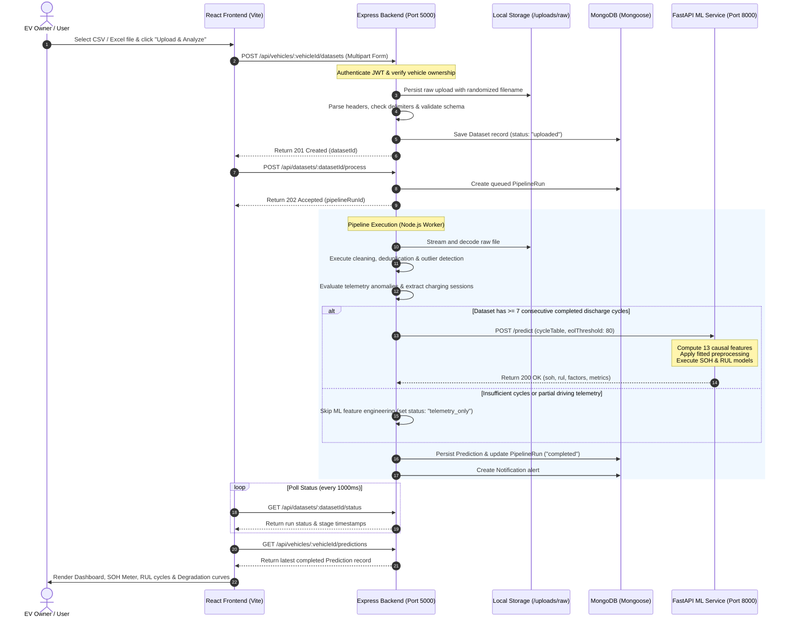
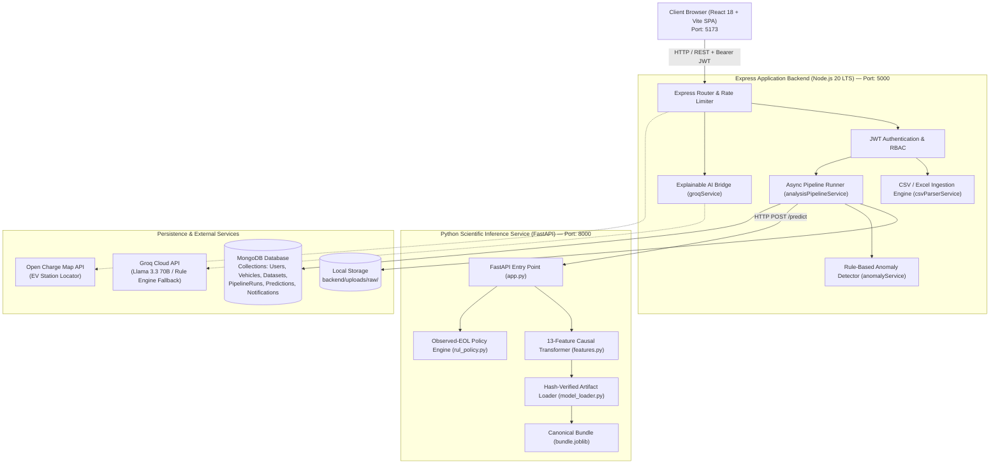

# VoltSense — AI-Powered EV Battery Health & Remaining Useful Life Prediction

[](https://nodejs.org/)
[](https://www.python.org/)
[](https://fastapi.tiangolo.com/)
[](https://react.dev/)
[](https://vitejs.dev/)
[](https://www.mongodb.com/)
[](https://scikit-learn.org/)
[](https://tailwindcss.com/)
[](https://github.com/Ashutoshr2207/VoltSense)

**VoltSense** is an end-to-end electric vehicle (EV) battery diagnostics and prognostics platform. It processes multi-format battery telemetry files (`.csv`, `.xlsx`, `.xls`), performs automated schema normalization, computes causal degradation features without future data leakage, predicts **State of Health (SOH)** and **Remaining Useful Life (RUL)** using trained machine learning models, screens for electrical and thermal anomalies, extracts authentic charging sessions, and delivers actionable, plain-language insights through an explainable AI assistant.

---

## Table of Contents

1. [Project Overview](#1-project-overview)
2. [Problem Statement & Core Objectives](#2-problem-statement--core-objectives)
3. [Key Features](#3-key-features)
4. [End-to-End Workflow](#4-end-to-end-workflow)
5. [System Architecture](#5-system-architecture)
6. [SOH and RUL Methodology](#6-soh-and-rul-methodology)
7. [Datasets and Data Standards](#7-datasets-and-data-standards)
8. [Model Training, Evaluation & Provenance](#8-model-training-evaluation--provenance)
9. [Technology Stack](#9-technology-stack)
10. [Repository Directory Structure](#10-repository-directory-structure)
11. [Prerequisites and Installation](#11-prerequisites-and-installation)
12. [Running VoltSense Locally](#12-running-voltsense-locally)
13. [Application URLs & Service Endpoints](#13-application-urls--service-endpoints)
14. [API Reference](#14-api-reference)
15. [Configuration & Environment Variables](#15-configuration--environment-variables)
16. [Sample Datasets & Demo Walkthrough](#16-sample-datasets--demo-walkthrough)
17. [Testing & Verification](#17-testing--verification)
18. [Deployment Guidelines](#18-deployment-guidelines)
19. [Scientific Caveats & Model Limitations](#19-scientific-caveats--model-limitations)
20. [Troubleshooting Guide](#20-troubleshooting-guide)
21. [Contributing & Development Guidelines](#21-contributing--development-guidelines)
22. [License and Acknowledgements](#22-license-and-acknowledgements)

---

## 1. Project Overview

Lithium-ion battery packs represent 30% to 50% of the total cost of an electric vehicle. Understanding battery degradation, estimating remaining lifespan, and detecting operating anomalies is essential for EV owners, fleet managers, and second-life battery refurbishers.

VoltSense provides an integrated software platform that bridges raw laboratory battery research, field vehicle telemetry, and everyday user decision-making:

- **What VoltSense does**: Accepts uploaded vehicle telemetry logs, validates and sanitizes input signals, extracts operating cycles and charging events, executes model inference via a decoupled microservice, stores immutable analysis history, and renders diagnostic metrics and degradation curves.
- **Intended Users**: EV owners monitoring personal battery degradation, commercial fleet supervisors tracking multi-vehicle battery health, battery technicians validating warranty claims, and academic researchers evaluating prognostics models.
- **Expected Outputs**:
  - **Empirical SOH (%)**: Current discharge capacity expressed as a percentage of initial fresh capacity.
  - **Model SOH (%)**: Machine-learning estimated State of Health.
  - **RUL (Cycles)**: Integer forecast of completed discharge cycles remaining before reaching the 80% end-of-life (EOL) retirement threshold.
  - **Pack & Cell Imbalance**: Pack-level spread metrics (`maxSpread`, `meanSpread`) when individual cell channels are available.
  - **Telemetry Anomalies**: Severity-tagged flags for over-voltage, under-voltage, extreme temperatures, and rapid thermal rises.
  - **Charging Metrics**: Extracted session durations, start/end SOC, and numerically integrated energy ($\int V \cdot I \, dt$).

---

## 2. Problem Statement & Core Objectives

### The Engineering Challenge
Battery capacity does not decline linearly. Degradation involves multiple complex electrochemical aging mechanisms:
1. **Loss of Lithium Inventory (LLI)** from Solid Electrolyte Interphase (SEI) growth.
2. **Loss of Active Material (LAM)** through mechanical particle cracking and electrode degradation.
3. **Ohmic Resistance Increase** through collector corrosion and electrolyte decomposition.

Furthermore, field EV telemetry is noisy, sampled at irregular rates, recorded at varying ambient temperatures, and frequently lacks explicit cycle counters.

### Core Project Objectives
1. **Zero Data Fabrication**: Never synthesize fake cell telemetry, simulated health percentages, or fictitious model confidence intervals.
2. **Strict Causal Feature Engineering**: Ensure every input feature for cycle $t$ uses exclusively historical observations strictly prior to cycle $t$, preventing future target leakage.
3. **Terminal Crossing Guard**: If a battery has already crossed the 80% EOL threshold in its observed history, return $\text{RUL} = 0$ cycles deterministically without relying on uncalibrated regressor extrapolation.
4. **Resilient Partial Analysis**: If an uploaded dataset contains valid driving or charging telemetry but lacks the consecutive discharge cycles required for machine learning, skip the ML stages gracefully and still provide telemetry statistics, charging session records, and anomaly detections.
5. **Architectural Separation of Concerns**: Isolate database writes and file management in Node.js/Express while keeping numerical computing and model inference isolated in Python/FastAPI.

---

## 3. Key Features

| Capability | Implementation Details |
|---|---|
| **Multi-Format Ingestion** | Supports `.csv`, `.xlsx`, and `.xls` files up to 50 MB with automatic delimiter detection (comma, semicolon, tab) and sheet decoding via `xlsx`. |
| **Flexible Column Mapping** | Maps abbreviations and variations (`volt`, `curr`, `temp`, `epoch`, `soc`, `time_s`) into canonical fields with exact-name collision resolution. |
| **Causal ML Inference** | Decoupled FastAPI microservice executing 13-feature causal transforms with pre-fitted Scikit-Learn pipelines. |
| **Dual Prognostic Targets** | Evaluates current Capacity/SOH alongside Remaining Useful Life (RUL) measured in completed discharge cycles. |
| **Rule-Based Anomaly Detection** | High-speed single-pass validator checking pack voltage limits, over-current thresholds, temperature bounds, and cell spreads. |
| **Charging Session Extraction** | Identifies charging intervals, calculates duration, records SOC change, and computes energy in kWh via trapezoidal integration. |
| **Session CSV Export** | One-click export of verified charging session logs with timestamps, energy bases, and data-quality warnings. |
| **Interactive 3D Battery Pack** | WebGL/Three.js 3D pack visualizer reflecting pack-level health status honestly, without fabricating fictitious cell readings. |
| **Explainable AI Assistant** | Translates model predictions into plain English using Groq Cloud LLMs (`llama-3.3-70b-versatile`) with an automatic rule-based fallback. |
| **Persistent History & Audit** | Immutable `PipelineRun` and `Prediction` audit trail stored in MongoDB; reopened historical analyses load their exact original data. |

---

## 4. End-to-End Workflow

The following sequence diagram outlines the entire lifecycle of an analysis, from initial client file selection to database persistence and dashboard visualization:



---

## 5. System Architecture

VoltSense is structured as three loosely coupled components operating over strict HTTP/JSON boundaries:



### Architectural Responsibilities

1. **Frontend (`frontend/src/`)**:
   - Single-page application built with React 18, Vite, and Tailwind CSS.
   - Manages user sessions, responsive layouts, 3D WebGL pack visualization via Three.js, Leaflet charging maps, and dynamic Chart.js degradation trends.
   - Communicates exclusively with the Node.js API gateway; never contacts Python or MongoDB directly.

2. **Backend API (`backend/src/`)**:
   - Node.js/Express server running on port `5000`.
   - Owns JWT authentication, user registration, vehicle records, raw file upload streaming (`multer`), schema mapping, data quality evaluation, anomaly detection, database persistence (`mongoose`), and notification dispatch.
   - Acts as the orchestration client calling the ML service.

3. **ML Inference Service (`ml-service/`)**:
   - Python 3.11 FastAPI server running on port `8000`.
   - Pure, stateless inference engine. Never accesses the database or filesystem outside its own artifact directory.
   - Enforces SHA-256 artifact verification, strictly validates input history arrays, builds causal features, and applies fitted Scikit-Learn pipelines.

4. **Persistence Layer**:
   - MongoDB database (local or Atlas) storing users, vehicles, datasets, pipeline runs, predictions, AI insights, and notifications.
   - Local filesystem storage (`backend/uploads/raw/<vehicleId>/`) holding immutable raw upload binaries.

---

## 6. SOH and RUL Methodology

### State of Health (SOH) Definition & Mathematics
State of Health expresses the current usable capacity of a battery relative to its initial observed fresh capacity:

$$\text{SOH}(t) = \min\left(100.0, \; 100.0 \times \frac{Q[t]}{Q[1]}\right)$$

Where:
- $Q[t]$ is the measured discharge capacity at cycle $t$ in Ampere-hours (Ah).
- $Q[1]$ is the reference capacity observed during the first complete discharge cycle ($t = 1$).
- **Status Categories**:
  - **Healthy**: $\text{SOH} \ge 90.0\%$
  - **Attention**: $80.0\% \le \text{SOH} < 90.0\%$
  - **Critical**: $\text{SOH} < 80.0\%$ (End-of-Life retirement threshold reached)

### Remaining Useful Life (RUL) Definition
RUL is defined strictly as the **number of remaining completed full discharge cycles** before the battery capacity drops to or below 80% of its initial reference capacity ($Q[1]$):

$$\text{RUL}(t) = \max\left(0, \; t_{\text{EOL}} - t\right) \quad \text{where } t_{\text{EOL}} = \min \{ c \mid Q[c] \le 0.80 \times Q[1] \}$$

> [!IMPORTANT]
> VoltSense measures RUL in **completed discharge cycles**, never in calendar days, years, or miles. Converting cycle counts into calendar life or driving distance without validated vehicle driving profiles and temperature histories is scientifically unsound.

### The 13 Causal Features Contract
To prevent future data leakage, all features for cycle $t$ are constructed strictly using observations prior to $t$:

| # | Feature Name | Mathematical Definition | Physical Description |
|---|---|---|---|
| 1 | `cycle_idx` | $t$ | Current cycle index (integer ordinal) |
| 2 | `log_cycle` | $\ln(1 + t)$ | Logarithmic aging transformation |
| 3 | `cycle_squared` | $t^2$ | Accelerated late-life degradation term |
| 4 | `cycle_sqrt` | $\sqrt{t}$ | Diffusion-limited SEI layer growth rate |
| 5 | `cap_lag1` | $Q[t-1]$ | Immediate prior discharge capacity (Ah) |
| 6 | `cap_lag2` | $Q[t-2]$ | Second prior discharge capacity (Ah) |
| 7 | `cap_lag5` | $Q[t-5]$ | Fifth prior discharge capacity (Ah) |
| 8 | `cap_roll3` | $\frac{1}{3}\sum_{i=1}^{3} Q[t-i]$ | 3-cycle moving average capacity |
| 9 | `cap_roll5` | $\frac{1}{5}\sum_{i=1}^{5} Q[t-i]$ | 5-cycle moving average capacity |
| 10 | `deg_rate` | $\frac{Q[1] - Q[t-1]}{t - 2}$ | Global cumulative capacity fade rate |
| 11 | `deg_rate5` | $\frac{Q[t-5] - Q[t-1]}{4}$ | Local short-term capacity fade velocity |
| 12 | `initial_cap` | $Q[1]$ | Baseline fresh reference capacity (Ah) |
| 13 | `cap_drop_pct` | $100 \times \frac{Q[1] - Q[t-1]}{Q[1]}$ | Cumulative percentage capacity drop |

### Terminal EOL Policy
In accordance with `rul_policy.py`:
- If any observed cycle in the history supplied up to cycle $t$ has already dropped to $\le 80\%$ of $Q[1]$, the system deterministically assigns $\text{RUL} = 0$ cycles.
- The regressor is **never invoked** on terminal histories, preventing model hallucination or capacity recovery artifacts.

---

## 7. Datasets and Data Standards

### Supported Ingestion Formats
- **CSV (`.csv`)**: Auto-detects comma (`,`), semicolon (`;`), and tab (`\t`) delimiters. UTF-8 and Latin-1 encoded.
- **Excel (`.xlsx`, `.xls`)**: Automatically decodes the first worksheet into standard tabular rows.

### Canonical CSV Column Schema
When providing cycle-level battery data (such as the provided synthetic demo files), use the canonical schema:

| Column Header | Data Type | Unit | Description |
|---|---|---|---|
| `battery_id` | String | — | Consistent identifier for the cell or pack (e.g. `SYNTHETIC_DEMO_001`) |
| `timestamp` | ISO 8601 | UTC | Datetime formatted as `YYYY-MM-DDTHH:MM:SS.sssZ` |
| `date` | String | `YYYY-MM-DD` | Calendar date derived from timestamp |
| `time` | String | `HH:MM:SS` | Clock time derived from timestamp |
| `Cycle` | Positive Integer | cycles | Physical cycle ordinal ($1, 2, 3, \dots, N$) |
| `Capacity` | Float (> 0) | Ah | Measured complete-discharge capacity |
| `mean_voltage` | Float | V | Cycle-average terminal voltage |
| `mean_current` | Float | A | Cycle-average current (negative for discharge) |
| `mean_temperature` | Float | °C | Cycle-average battery cell temperature |
| `discharge_duration` | Float | seconds | Elapsed discharge duration |
| `type` | String | — | Operation tag (`discharge`, `charge`, `rest`) |

### Flexible Column Aliases
The parser automatically maps common real-world telemetry column name variations:

- **Voltage**: `voltage`, `voltage_measured`, `battery_voltage`, `hv_voltage`, `pack_voltage`, `cell_voltage`, `v`, `volt`, `volts`, `pack_v`
- **Current**: `current`, `current_measured`, `battery_current`, `hv_current`, `pack_current`, `i`, `curr`, `current_a`, `pack_i`, `amperes`
- **Temperature**: `temperature`, `temperature_measured`, `battery_temp`, `temp`, `cell_temperature`, `t`, `temp_c`, `temperature_c`
- **State of Charge**: `soc`, `state_of_charge`, `displayed_soc`, `soc_percent`, `battery_level`
- **Timestamp**: `timestamp`, `date_time`, `iso_timestamp`, `epoch`, `time_epoch`, `utc_timestamp`
- **Time Elapsed**: `time`, `relative_time`, `time_s`, `time_seconds`, `seconds`, `elapsed_time`

### Preprocessing and Validation Rules
1. **Deduplication**: Exact duplicate data rows are discarded; conflicting timestamps are rejected.
2. **Cycle Continuity**: SOH and RUL model inference requires at least **7 complete consecutive discharge cycles** beginning at cycle 1.
3. **Partial Analysis Execution**: Telemetry files lacking cycle counts or consecutive cycles skip ML feature engineering without failing, allowing pack stats, voltage spreads, anomaly checks, and charging history to be recorded.

---

## 8. Model Training, Evaluation & Provenance

### Model Artifact Identity
- **Bundle File**: [`ml-service/models/canonical/bundle.joblib`](file:///r:/PP/VoltSense/ml-service/models/canonical/bundle.joblib)
- **Manifest**: [`ml-service/models/canonical/manifest.json`](file:///r:/PP/VoltSense/ml-service/models/canonical/manifest.json)
- **SHA-256**: `d0c845dccd6524850618ccc37503b92a8753b512e013b24d3c52725b4f59ff46`
- **Architecture**:
  - Capacity / SOH: `GradientBoostingRegressor` (100 estimators, max depth 3) with `StandardScaler`
  - RUL: `RandomForestRegressor` (100 estimators, random state 42) with `StandardScaler`

### NASA Dataset Provenance
Models were trained and evaluated on the **NASA Ames Prognostics Center of Excellence (PCoE)** Li-ion Battery Aging Dataset:
- **Batteries Evaluated (14 total)**: `B0005`, `B0006`, `B0007`, `B0018`, `B0025`, `B0027`, `B0028`, `B0029`, `B0030`, `B0031`, `B0032`, `B0046`, `B0047`, `B0048`
- **Data Volume**: 929 validated completed discharge cycles.
- **Split Strategy**: Strictly partitioned by battery identity (battery-disjoint) before fitting:
  - **Train (8 batteries)**: `B0005`, `B0006`, `B0025`, `B0027`, `B0028`, `B0029`, `B0046`, `B0047` (511 cycles)
  - **Validation (3 batteries)**: `B0007`, `B0030`, `B0048` (209 cycles)
  - **Test (3 batteries)**: `B0018`, `B0031`, `B0032` (209 cycles)

### Candidate Evaluation Metrics (Held-out Battery-Disjoint Test)

| Metric | Capacity Model (GradientBoosting) | SOH Equivalent (%) | RUL Model (RandomForest) | Baseline Comparison |
|---|---|---|---|---|
| **MAE** | `0.0110 Ah` | `0.55%` | `8.74 cycles` | Baseline Linear SOH MAE: `1.42%` |
| **RMSE** | `0.0163 Ah` | `0.88%` | `10.90 cycles` | Baseline Linear SOH RMSE: `2.15%` |
| **$R^2$ Score** | `0.988` | `0.989` | `0.924` | Naive Persistence $R^2$: `0.891` |

> [!NOTE]
> In accordance with repository guardrails, the model is formally tracked with `approved: false` and `is_experimental: true` because external validation on production automotive traction packs (as opposed to laboratory 18650 cells) remains open.

### Reproducing Model Training
To retrain the canonical pipelines from the validated NASA data:
```powershell
cd ml-service
.\.venv\Scripts\Activate.ps1
python -m training
```

---

## 9. Technology Stack

| Layer | Technology | Version | Purpose |
|---|---|---|---|
| **Frontend Framework** | React | `18.3.1` | Declarative user interface and component state management |
| **Build Tool & Server** | Vite | `5.4.8` | Modern ES-module development server and production bundler |
| **Styling & Design System** | Tailwind CSS | `3.4.13` | Utility-first CSS adhering to VoltSense Design Tokens |
| **3D Graphics** | Three.js | `0.186.1` | WebGL interactive 3D battery pack visualization |
| **Mapping Engine** | Leaflet | `1.9.4` | Interactive charging station mapping |
| **Frontend Testing** | Vitest & React Testing Library | `2.1.9` / `16.3.0` | Component unit testing and smoke test verification |
| **Backend Runtime** | Node.js | `>=18.0.0` (LTS) | Asynchronous backend JavaScript runtime |
| **Web Framework** | Express | `4.19.2` | RESTful API routing, middleware, and request handling |
| **Database ODM** | Mongoose | `8.4.1` | MongoDB document modeling, schemas, and indexing |
| **Authentication** | JSON Web Tokens & bcryptjs | `9.0.2` / `2.4.3` | Stateless Bearer token auth and secure password hashing |
| **File Parsing** | SheetJS (`xlsx`) & Multer | `0.18.5` / `1.4.5` | Multipart file upload streaming and spreadsheet parsing |
| **Backend Testing** | Jest & Supertest | `29.7.0` / `7.0.0` | Comprehensive integration tests with in-memory MongoDB |
| **ML Service Runtime** | Python | `3.11` | Scientific computing and machine learning runtime |
| **API Framework** | FastAPI & Uvicorn | `0.100+` / `0.20+` | High-performance asynchronous REST API for model serving |
| **ML Framework** | Scikit-Learn | `1.6.1` | Preprocessing pipelines, GradientBoosting, and RandomForest |
| **Array & Data Processing** | NumPy & Pandas | `2.x` | High-frequency time-series alignment and causal transforms |
| **Model Serialization** | Joblib | `1.6.0` | Efficient serialization of Scikit-Learn pipeline artifacts |

---

## 10. Repository Directory Structure

```text
VoltSense/
├── .agents/                        # AI development skills and brand rules
├── backend/                        # Node.js / Express API Service (Port 5000)
│   ├── scripts/                    # Database seeding scripts (seed.js)
│   ├── src/
│   │   ├── config/                 # Environment validation and DB configuration
│   │   ├── controllers/            # Request handlers (auth, vehicle, dataset, etc.)
│   │   ├── middleware/             # JWT auth, error handler, rate limiters, upload
│   │   ├── models/                 # Mongoose schemas (User, Vehicle, Dataset, Prediction, etc.)
│   │   ├── routes/                 # Express REST endpoint declarations
│   │   ├── services/               # Orchestration logic (pipeline, parser, groq, mlClient)
│   │   ├── utils/                  # API responses, error classes, ID formatting
│   │   ├── app.js                  # Express application setup
│   │   └── server.js               # HTTP listener and MongoDB bootstrap
│   ├── tests/                      # Jest test suites (pipeline, auth, datasets, mlClient)
│   ├── uploads/raw/                # Local storage for uploaded telemetry binaries
│   ├── .env.example                # Backend environment configuration template
│   └── package.json                # Backend dependencies and test scripts
├── data/                           # Battery datasets and research catalogues
│   ├── mendeley/                   # Stanford EV Field Dataset (Bosoni et al., 2023)
│   │   ├── Charge/                 # High-voltage pack charging folders (Folder1, Folder11)
│   │   ├── convert_to_csv.py       # In-place HDF5 (.mat) to CSV converter
│   │   └── ReadMe.docx             # Official dataset documentation
│   ├── processed/                  # Unified 400,000-row research catalogue
│   ├── validated/                  # NASA PCoE cleaned cycles and split manifests
│   └── [Nasa, XJTU, oxford, hstu]  # Raw local reference datasets (excluded from Git)
├── docs/                           # 22 verified project documentation files
│   ├── architecture.md             # System architecture and runtime boundaries
│   ├── api-reference.md            # Route inventory and request/response shapes
│   ├── data-pipeline.md            # Ingestion, validation, and pipeline mechanics
│   ├── database-schema.md          # Complete Mongoose collection schemas
│   └── ml-backend-contract.md      # Express ↔ FastAPI JSON contract
├── frontend/                       # React / Vite Client Application (Port 5173)
│   ├── public/                     # Static assets, icons, and manifests
│   ├── smoke/                      # Vitest smoke tests (pages, context, processing)
│   ├── src/
│   │   ├── api/                    # Axios/fetch API wrappers (auth, vehicle, prediction)
│   │   ├── components/             # UI elements, modals, 3D pack visualizer, charts
│   │   ├── context/                # Global state provider (AppContext)
│   │   ├── hooks/                  # Custom React hooks (useVehicleDetail)
│   │   ├── pages/                  # Page views (Dashboard, BatteryHealth, Insights, Charging)
│   │   ├── utils/                  # Formatters, battery calculators, insight rules
│   │   ├── App.jsx                 # Route manager and layout wrapper
│   │   └── index.css               # Tailwind design system tokens
│   ├── package.json                # Frontend dependencies and scripts
│   └── vite.config.js              # Vite build configuration
├── ml-service/                     # Python FastAPI Inference Microservice (Port 8000)
│   ├── models/canonical/           # Canonical models (bundle.joblib, manifest.json)
│   ├── scripts/                    # Verification and evaluation utilities
│   ├── tests/                      # Pytest test suite (inference, features, conversion)
│   ├── app.py                      # FastAPI application entry point
│   ├── features.py                 # Causal 13-feature engineering implementation
│   ├── model_loader.py             # Hash-validated model bundle loader
│   ├── requirements.txt            # Python dependencies (scikit-learn==1.6.1)
│   └── rul_policy.py               # Observed-EOL terminal guard logic
├── own_docs/                       # Audit and dataset assessment documentation
│   ├── remaining_fixes_audit.md    # 37-point requirement audit and resolution log
│   ├── mendeley_dataset_assessment.md # Stanford dataset scientific evaluation
│   └── issues.md                   # Complete 37-point requirements checklist
├── sample_data/                    # Canonical user sample datasets and legacy benchmarks
│   ├── manifest.json               # Machine-readable catalog and validation metadata
│   ├── scripts/                    # Generation and end-to-end verification scripts
│   ├── legacy/                     # Preserved single-cell synthetic benchmark CSVs
│   ├── user1/                      # Sarah Chen (Tesla Model 3 LR AWD, 82 kWh)
│   ├── user2/                      # Marco Rossi (BYD Atto 3 Extended Range, 60.5 kWh LFP)
│   ├── user3/                      # Aarav Patel (Tata Nexon EV Max, 40.5 kWh Ziptron)
│   ├── user4/                      # David Lindholm (Hyundai Ioniq 5 LR AWD, 77.4 kWh 800V)
│   └── README.md                   # Comprehensive sample dataset suite documentation
├── .gitignore                      # Git exclusion rules for large datasets and envs
├── AGENTS.md                       # Repository rules and architectural guardrails
└── README.md                       # Root documentation (this file)
```

---

## 11. Prerequisites and Installation

### System Requirements
- **Node.js**: Version `18.18.0` or higher (Node 20+ LTS recommended)
- **npm**: Version `9.0.0` or higher
- **Python**: Version `3.11.x` (Python 3.11.9 verified)
- **MongoDB**: Version `7.0+` locally, or a free [MongoDB Atlas](https://www.mongodb.com/atlas) connection string
- **Operating System**: Windows 10/11 (PowerShell), macOS, or Linux

---

### Step 1: Clone the Repository
```powershell
git clone https://github.com/Ashutoshr2207/VoltSense.git
cd VoltSense
```

---

### Step 2: Configure Environment Variables
Copy the template configuration to `backend/.env`:
```powershell
Copy-Item backend\.env.example backend\.env
```

Open `backend/.env` and ensure the values match your local environment:
```ini
NODE_ENV=development
PORT=5000
MONGODB_URI=mongodb://127.0.0.1:27017/voltsense
MONGODB_DATABASE=voltsense
JWT_SECRET=super_secret_jwt_key_minimum_32_characters_long_for_security
JWT_EXPIRES_IN=7d
CORS_ORIGIN=http://localhost:5173
MAX_FILE_SIZE_MB=50
ML_SERVICE_URL=http://127.0.0.1:8000

# Optional: Groq Cloud API Key for plain-language LLM explanations
GROQ_API_KEY=
GROQ_MODEL=llama-3.3-70b-versatile

# Optional: Open Charge Map API Key for charging station discovery
OCM_API_KEY=
```

---

### Step 3: Install Service Dependencies

#### 1. Backend Dependencies
```powershell
cd backend
npm ci
cd ..
```

#### 2. Frontend Dependencies
```powershell
cd frontend
npm ci
cd ..
```

#### 3. Python ML Service Virtual Environment
```powershell
cd ml-service
python -m venv .venv
.\.venv\Scripts\Activate.ps1
pip install -r requirements.txt
cd ..
```

---

## 12. Running VoltSense Locally

VoltSense requires three terminal sessions running concurrently. Open **three separate PowerShell terminals** from the repository root:

### Terminal 1: ML Inference Service (FastAPI)
```powershell
cd R:\PP\VoltSense\ml-service
.\.venv\Scripts\Activate.ps1
python -m uvicorn app:app --host 127.0.0.1 --port 8000
```
*Expected output*: `Uvicorn running on http://127.0.0.1:8000`

---

### Terminal 2: Application API Gateway (Express)
```powershell
cd R:\PP\VoltSense\backend
npm run dev
```
*Expected output*:
```text
MongoDB Connected: 127.0.0.1/voltsense
VoltSense Backend running in [development] mode on port 5000
Health endpoint available at http://localhost:5000/api/health
```

---

### Terminal 3: Web Client (React + Vite)
```powershell
cd R:\PP\VoltSense\frontend
npm run dev
```
*Expected output*: `VITE v5.4.8 ready in 250 ms ➜ Local: http://localhost:5173/`

---

### Verifying Service Connectivity
Run this command from any PowerShell terminal to verify all three services are active:
```powershell
# 1. Check ML Service
Invoke-RestMethod http://127.0.0.1:8000/health

# 2. Check Backend Gateway
Invoke-RestMethod http://localhost:5000/api/health
```

---

## 13. Application URLs & Service Endpoints

| Service | Protocol / URL | Description |
|---|---|---|
| **Web Dashboard** | `http://localhost:5173` | React Single-Page Application |
| **Backend REST API** | `http://localhost:5000/api` | Primary Express API gateway |
| **Backend Health Check** | `http://localhost:5000/api/health` | Node server, uptime, and database status |
| **ML Inference Service** | `http://127.0.0.1:8000` | Python FastAPI prediction microservice |
| **ML Health Check** | `http://127.0.0.1:8000/health` | Checks loaded model bundle and SHA-256 |
| **Interactive API Docs** | `http://127.0.0.1:8000/docs` | Swagger / OpenAPI UI for the ML service |

---

## 14. API Reference

All backend API routes are prefixed with `/api`. Protected routes require the `Authorization: Bearer <token>` header.

### Authentication & Users
| Method | Endpoint | Auth | Description |
|---|---|---|---|
| `POST` | `/api/auth/register` | No | Register a new user (`name`, `email`, `password`) |
| `POST` | `/api/auth/login` | No | Authenticate credentials and receive JWT |
| `GET` | `/api/auth/me` | Yes | Get currently authenticated user profile |
| `GET` | `/api/users/profile` | Yes | Retrieve full profile details |
| `PATCH` | `/api/users/profile` | Yes | Update user display name and preferences |
| `PUT` | `/api/users/password` | Yes | Change user password |

### Vehicles
| Method | Endpoint | Auth | Description |
|---|---|---|---|
| `GET` | `/api/vehicles` | Yes | List all owned vehicles for the active user |
| `POST` | `/api/vehicles` | Yes | Add a new vehicle (`manufacturer`, `model`, `year`, `vin`) |
| `GET` | `/api/vehicles/:vehicleId` | Yes | Retrieve vehicle telemetry summary and latest SOH/RUL |
| `PATCH` | `/api/vehicles/:vehicleId` | Yes | Update vehicle metadata or pack capacity (kWh) |
| `DELETE` | `/api/vehicles/:vehicleId` | Yes | Cascade delete vehicle, raw uploads, and predictions |

### Datasets & Processing
| Method | Endpoint | Auth | Description |
|---|---|---|---|
| `POST` | `/api/vehicles/:vehicleId/datasets` | Yes | Multipart upload (`file`, `sourceType`) |
| `GET` | `/api/vehicles/:vehicleId/datasets` | Yes | List uploaded datasets for a vehicle |
| `GET` | `/api/datasets/:datasetId` | Yes | Get dataset record, schema info, and column stats |
| `DELETE` | `/api/datasets/:datasetId` | Yes | Delete an idle dataset and its local binary |
| `POST` | `/api/datasets/:datasetId/process` | Yes | Trigger pipeline execution (`pipelineRunId`) |
| `GET` | `/api/datasets/:datasetId/status` | Yes | Poll progress, stage timestamps, and errors |

### Predictions & AI Insights
| Method | Endpoint | Auth | Description |
|---|---|---|---|
| `GET` | `/api/vehicles/:vehicleId/predictions` | Yes | List historical predictions for a vehicle |
| `GET` | `/api/predictions/:predictionId` | Yes | Retrieve full prediction record, cycles, and curves |
| `GET` | `/api/predictions/:predictionId/insights` | Yes | Retrieve persisted AI insights and recommendations |
| `POST` | `/api/predictions/:predictionId/explain` | Yes | Query Groq LLM with a custom question |

### Anomalies & Charging
| Method | Endpoint | Auth | Description |
|---|---|---|---|
| `GET` | `/api/vehicles/:vehicleId/anomalies` | Yes | List detected anomalies with severity and timestamps |
| `GET` | `/api/vehicles/:vehicleId/anomalies/stats` | Yes | Aggregate anomaly statistics by type and severity |
| `PATCH` | `/api/vehicles/:vehicleId/anomalies/:id/resolve` | Yes | Mark an anomaly as reviewed/resolved |
| `GET` | `/api/charging-stations` | Yes | Search nearby charging stations via Open Charge Map |

---

## 15. Configuration & Environment Variables

### Backend Variables (`backend/.env`)

| Variable | Type | Default | Description |
|---|---|---|---|
| `PORT` | Integer | `5000` | Port for Express HTTP listener |
| `NODE_ENV` | String | `development` | Environment mode (`development`, `test`, `production`) |
| `MONGODB_URI` | String | `mongodb://127.0.0.1:27017/voltsense` | MongoDB connection URI (local or Atlas) |
| `MONGODB_DATABASE` | String | `voltsense` | Target database name |
| `JWT_SECRET` | String | *Required* | Secret key for signing JWTs (min 32 chars) |
| `JWT_EXPIRES_IN` | String | `7d` | Token lifetime (`1d`, `7d`, `30d`) |
| `CORS_ORIGIN` | String | `http://localhost:5173` | Allowed origin for CORS headers |
| `MAX_FILE_SIZE_MB` | Integer | `50` | Maximum upload size in megabytes |
| `ML_SERVICE_URL` | String | `http://127.0.0.1:8000` | Base URL of the Python FastAPI service |
| `ML_SERVICE_TIMEOUT_MS`| Integer | `20000` | Timeout in ms before marking ML service unreachable |
| `GROQ_API_KEY` | String | *Optional* | API key for Groq Cloud LLM assistant |
| `GROQ_MODEL` | String | `llama-3.3-70b-versatile` | Groq model identifier |
| `OCM_API_KEY` | String | *Optional* | Open Charge Map API key for station locator |

---

## 16. Sample Datasets & Demo Walkthrough

A consolidated suite of **four source-informed, operational EV datasets (one complete CSV per EV owner)** is provided in [`sample_data/`](sample_data/README.md), covering an exact **150-calendar-day observation window** (`2026-01-01` to `2026-05-30`):

| Owner Dataset | Vehicle & Architecture | Daily Records | Completed Cycles | Charging Sessions | SOH Degradation | Key Scenarios & Anomalies |
|---|---|---|---|---|---|---|
| **[`sample_data/owner_1.csv`](sample_data/owner_1.csv)** | **Tesla Model 3 Long Range (2023)** (82 kWh, 389.4V NCA/NMC) | 150 rows | 30 cycles (1 cycle / 5 days) | 30 sessions | 209.61 $\to$ 206.85 Ah (98.7% empirical SOH) | Baseline passenger EV, home L2 AC charging, healthy battery (0 anomalies) |
| **[`sample_data/owner_2.csv`](sample_data/owner_2.csv)** | **BYD Atto 3 Extended Range (2023)** (60.5 kWh, 403.2V LFP Blade) | 150 rows | 37 cycles (1 cycle / ~4 days) | 37 sessions | 149.77 $\to$ 147.90 Ah (98.8% empirical SOH) | LFP chemistry, Day 68 cell voltage spread imbalance (0.165V > 0.15V) |
| **[`sample_data/owner_3.csv`](sample_data/owner_3.csv)** | **Tata Nexon EV Max (2023)** (40.5 kWh, 320.0V LFP Ziptron) | 150 rows | 25 cycles (1 cycle / 6 days) | 25 sessions | 125.71 $\to$ 123.85 Ah (98.5% empirical SOH) | Dense urban driving, Day 112 afternoon thermal excursion (46.5°C > 45°C) |
| **[`sample_data/owner_4.csv`](sample_data/owner_4.csv)** | **Hyundai Ioniq 5 LR AWD (2023)** (77.4 kWh, 697.0V 800V NCM) | 150 rows | 42 cycles (1 cycle / ~3.5 days) | 42 sessions | 110.73 $\to$ 108.35 Ah (97.9% empirical SOH) | High-mileage highway, Day 42 thermistor dropout, Day 95 under-voltage (2.74V) |

> [!NOTE]
> All 4 files are generated via [`sample_data/generate_demo_datasets.py`](sample_data/generate_demo_datasets.py) and verified end-to-end against `csvParserService.js` and `anomalyService.js`. Every file contains the complete canonical schema including `charge_duration` for automated charging session extraction.

### Performing a Demonstration in 5 Steps:
1. Open `http://localhost:5173` and register a new test user account (e.g. `demo@voltsense.io`).
2. Navigate to **Vehicle Profile** and view your registered vehicle (e.g., `Tesla Model 3`, `2023`).
3. Click **SOH & RUL** in the sidebar, click **Choose CSV / Excel**, and select [`sample_data/owner_1.csv`](sample_data/owner_1.csv).
4. Review the 150-record preview table and click **Upload & Analyze**. Watch the real-time stage progress bar:
   - *Validation* ➜ *Schema Mapping* ➜ *Cleaning* ➜ *Feature Engineering* ➜ *ML Inference* ➜ *Persistence*.
5. Inspect the generated results:
   - **Dashboard**: View the dynamic 3D pack visualization colored by SOH.
   - **Insights**: Review degradation curves and ask the Explainable AI Assistant questions about battery health.
   - **Anomalies**: Inspect flagged cell imbalances, temperature warnings, or telemetry dropouts.

---

## 17. Testing & Verification

VoltSense includes automated testing across the entire stack.

### 1. Backend Integration Tests (Jest)
Runs 17 test suites using an in-memory MongoDB server (`mongodb-memory-server`):
```powershell
cd backend
npm test
```
*Verification Output*: **17 passed, 125 passed, 0 failures (24.0s)**

### 2. Frontend Smoke Tests (Vitest)
Executes component mounting, navigation, and state tests via jsdom:
```powershell
cd frontend
npm run test:smoke
```
*Verification Output*: **4 passed, 39 passed, 0 failures (2.86s)**

### 3. Frontend Production Build
Validates bundling, chunking, and asset compilation:
```powershell
cd frontend
npm run build
```
*Verification Output*: `✓ built in 4.48s (dist/assets/index-CfSZZ3vf.js)`

### 4. ML Service Tests (Pytest)
Validates feature engineering, terminal EOL policy, and artifact integrity:
```powershell
cd ml-service
.\.venv\Scripts\Activate.ps1
python -m pytest tests -v
```

---

## 18. Deployment Guidelines

### Local Development Topology (Current Implemented Target)
VoltSense is designed and tested for local multi-process execution as documented in [Section 12](#12-running-voltsense-locally).

### Production Deployment Target (Planned Architecture)
In accordance with [`docs/deployment.md`](file:///r:/PP/VoltSense/docs/deployment.md):
- **Frontend SPA**: Pre-compiled production bundle (`frontend/dist/`) deployed to static global edge hosting (Vercel, Cloudflare Pages, or AWS S3 + CloudFront).
- **Backend API**: Node.js container deployed to AWS ECS, Google Cloud Run, or Render with managed autoscaling.
- **ML Microservice**: Python 3.11 container deployed to a CPU-optimized container service (AWS ECS or Cloud Run).
- **Database**: Managed MongoDB Atlas replica set with automated backups and TLS encryption.
- **Storage**: AWS S3 or Google Cloud Storage bucket replacing local filesystem storage.

---

## 19. Scientific Caveats & Model Limitations

To maintain academic and scientific integrity, the following limitations are explicitly documented:

1. **Cell-Level vs. Pack-Level Gap**:
   - The canonical models were trained on NASA Ames laboratory single 18650 cylindrical cells cycled under controlled ambient temperatures.
   - Real electric vehicles use complex battery packs consisting of thousands of cells organized in series and parallel modules with active thermal management and variable driving profiles.
   - Predictions should be interpreted as diagnostic estimations, not factory-certified battery warranty determinations.
2. **Cycle Ordinal Requirements**:
   - The machine-learning models require dense, consecutive discharge cycle observations. If vehicle logs only capture sub-second instantaneous driving without completed cycles, VoltSense performs rule-based telemetry analysis rather than running ungrounded ML inference.
3. **No Fabricated Confidence Bounds**:
   - VoltSense reports `confidence.uncertaintyInterval: "Unavailable"` unless empirically calibrated against independent ground truth. Fabricated error bars are strictly prohibited.
4. **Third-Party Telematics Limitations**:
   - Smartcar simulator connectivity is subject to vendor credentials. When vehicle APIs do not provide raw voltage or cell-level telemetry, VoltSense displays `Not recorded` rather than synthesizing simulated values.

---

## 20. Troubleshooting Guide

### 1. `ML inference unavailable: unreachable`
- **Cause**: The Node backend cannot establish an HTTP connection to the FastAPI ML service.
- **Solution**: Open Terminal 1, activate `ml-service/.venv`, and start the service:
  ```powershell
  python -m uvicorn app:app --host 127.0.0.1 --port 8000
  ```
  Verify by navigating to `http://127.0.0.1:8000/health`.

### 2. `Inference requires complete consecutive discharge history beginning at cycle 1`
- **Cause**: An uploaded cycling dataset has missing cycles (e.g. cycle 1, 2, 4).
- **Solution**: The NASA-trained causal feature pipeline requires contiguous cycles. Ensure your cycle table is numbered consecutively starting at 1. Alternatively, upload time-series telemetry without a cycle column to execute partial telemetry diagnostics.

### 3. Port Already in Use (`EADDRINUSE: 5000` or `Port 8000`)
- **Cause**: A previous server instance was not terminated cleanly.
- **Solution**: Identify and stop the lingering process in PowerShell:
  ```powershell
  Get-Process -Id (Get-NetTCPConnection -LocalPort 5000).OwningProcess | Stop-Process -Force
  ```

### 4. Groq Assistant Notice: "Explanations are generated by the verified deterministic rule engine"
- **Cause**: `GROQ_API_KEY` is not set in `backend/.env`, or the Groq API rate limit was exceeded.
- **Solution**: This is a non-blocking informational fallback. VoltSense automatically generates verified rule-based battery diagnostic summaries from your actual data without crashing. To enable generative explanations, register a free key at [Groq Console](https://console.groq.com/) and paste it into `backend/.env`.

---

## 21. Contributing & Development Guidelines

1. **Adhere to Code Standards**:
   - JavaScript: Two-space indentation, single quotes, semicolons. CommonJS in backend; ES modules in frontend.
   - Python: Four-space indentation, snake_case functions, type hints where practical.
2. **Preserve API & Model Contracts**:
   - Never change existing REST endpoint paths, request shapes, or database field names without explicit team consensus.
   - Never retrain models incidentally or overwrite canonical model bundles (`ml-service/models/canonical/`).
3. **Run Pre-Commit Verification**:
   Always execute all test suites before submitting changes:
   ```powershell
   # In backend
   npm test

   # In frontend
   npm run test:smoke
   npm run build
   ```

---

## 22. License and Acknowledgements

### License
This project is developed for educational and academic research purposes as a Capstone Engineering Project.

### Dataset & Academic Acknowledgements
- **NASA Ames Prognostics Center of Excellence (PCoE)**: B. Saha and K. Goebel (2007), *Battery Data Set*, NASA Ames Research Center, Moffett Field, CA.
- **Stanford Energy Control Laboratory**: P. Bosoni, G. Pozzato, and S. Onori (2023), *Field data from electric vehicles: A comprehensive dataset for battery health monitoring*, Stanford University / Mendeley Data, [doi:10.17632/7vdkzpnjgj.1](https://data.mendeley.com/datasets/7vdkzpnjgj.1).
- **Open Charge Map**: Global public registry of electric vehicle charging locations.
