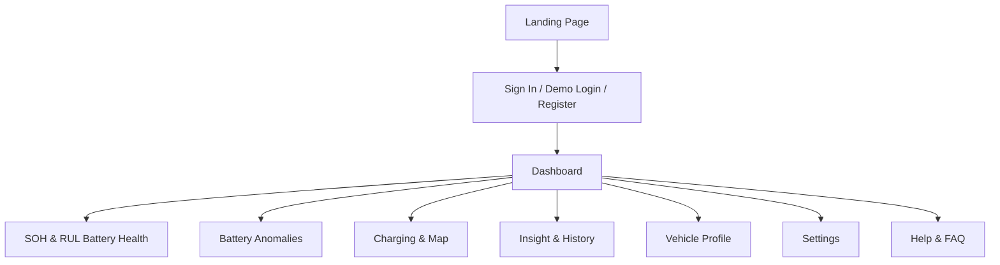
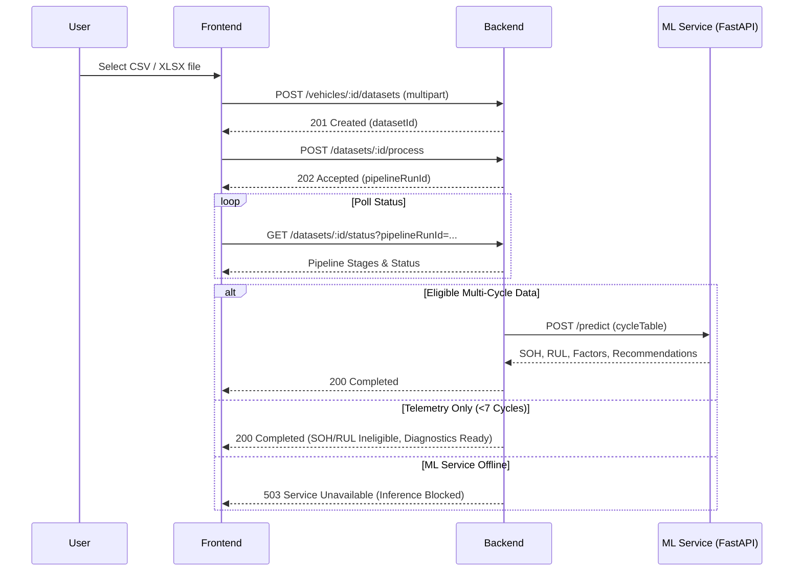
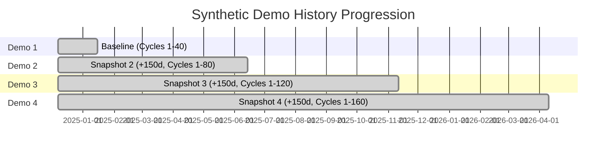

# VoltSense — Frontend Requirements & Information Architecture (IA)

> **Document Status:** Authoritative Architecture & Product Specification  
> **Target Release:** VoltSense V2 / V3 Stabilization  
> **Source Evidence:** `AGENTS.md`, backend routes & controllers, Mongoose models, FastAPI ML service, CSV ingestion pipeline, and demo datasets 1–4.

---

## Executive Summary

VoltSense is an EV battery health analytics platform designed to ingest battery telemetry files, evaluate operational safety, estimate State of Health (SOH), predict Remaining Useful Life (RUL) in discharge cycles to an 80% End-of-Life (EOL) threshold, extract charging sessions, and provide explainable AI diagnostics.

This document establishes the **Frontend Requirements & Information Architecture**. It defines what every page must display, why it matters, where data originates, and how users interact with it. It enforces scientific honesty, highlights gaps and contradictions in the current codebase, and categorizes all platform capabilities into **Currently Supported**, **Partially Supported**, and **Not Yet Supported**.

---

## 1. User Goals & Core Journeys

| Goal | Description | Primary Outcome |
|---|---|---|
| **Understand Current Battery Health** | Know the true State of Health (SOH %) and usable capacity retention (Ah) vs. when the battery was new. | Clear status (`Healthy`, `Attention`, `Critical`), SOH %, and usable capacity loss in Ah and %. |
| **Project Remaining Lifespan** | Estimate remaining completed discharge cycles before capacity degrades to the 80% EOL threshold. | RUL integer cycles and estimated EOL cycle index. |
| **Ingest Telemetry Seamlessly** | Upload standard battery CSV or Excel files and verify format compatibility before processing. | Clear 7-stage processing tracker, 5-point analysis report, and immediate failure diagnostics. |
| **Detect Operational Anomalies** | Catch cell-to-cell voltage imbalance, temperature excursions, and over-current events. | Grouped anomaly findings with severity ratings and specific mitigation recommendations. |
| **Track Degradation Over Time** | Observe how battery capacity and health evolve across successive measurement snapshots. | Chronological evaluation log and multi-cycle degradation curve ordered by measurement date. |
| **Analyze Charging Behavior** | Review charging performance, energy delivered (kWh), and duration across recorded sessions. | Table of verified charging sessions with downloadable CSV cycle summaries. |
| **Locate Charging Infrastructure** | Discover nearby charging stations reachable within current battery SOC range. | Interactive map with GPS locate, range radius buffer, and station specs (kW, plugs). |
| **Query Plain-Language Diagnostics** | Ask natural-language questions about battery degradation and receive grounded, non-hallucinated explanations. | Groq LLM-assisted or rule-based plain-English explanation. |

---

## 2. Page-by-Page Requirements



### 2.1. Landing Page (`landing`)
- **Purpose:** Public entrance and value proposition for unauthenticated visitors.
- **Essential Information:** Explanation of VoltSense's capabilities (multi-cycle degradation tracking, physics-backed SOH/RUL regression, rule-based anomaly screening).
- **Actions:**
  - `Sign In` $\to$ navigates to `SignIn` (login mode).
  - `Create Account` $\to$ navigates to `SignIn` (register mode).
  - `Launch Interactive Demo` $\to$ performs one-click demo login with the pre-seeded account.

### 2.2. Authentication (`signin` / `register`)
- **Purpose:** Secure user onboarding and session establishment.
- **Essential Information:** Email and password fields, name (registration only), validation error banners.
- **Actions:**
  - Standard email/password submit.
  - One-click `Try Demo Account` button (logs in as `demo@voltsense.io` without requiring manual credentials).
  - Mode toggle between Sign In and Register.

### 2.3. Dashboard (`dashboard`)
- **Purpose:** High-level executive overview of the active vehicle's operational status and recent analysis.
- **Essential Information:**
  - Greeting with user name and active vehicle context.
  - Overall status banner (`System Operational — Healthy`, `Attention Required`, or `Awaiting First Upload`).
  - Metric summary cards:
    - **Analysed Uploads:** Count of processed dataset files for this vehicle.
    - **Unresolved Anomalies:** Total active telemetry safety excursions.
    - **Analysis Status:** Status of latest dataset (`Completed`, `Partially Completed`, `Processing`, `Failed`, or `No upload yet`).
  - **Latest Telemetry Finding Card:** Plain-language summary of recent voltage balance and thermal profile, with quick readouts for SOH %, SOC %, and Remaining Cycles.
  - **Quick Action Hub:** Direct navigation cards to `Battery Health`, `Battery Anomalies`, `Charging Stations`, and `Insight`.
- **Navigation:**
  - Primary CTA: `Analyze Battery Health` $\to$ navigates to `BatteryHealth`.
  - Secondary CTA: `Review Anomalies` $\to$ navigates to `BatteryAnomalies`.

### 2.4. Battery Health (`analysis` / `upload`)
- **Purpose:** The primary analytical engine and dataset upload interface.
- **Essential Information:**
  - **Upload Dropzone (`CsvUploadPanel`):** Drag-and-drop file target accepting `.csv`, `.xlsx`, `.xls` with 5-point client-side eligibility pre-check.
  - **Pipeline Processing Status (`DatasetStatusPanel`):** Persistent tracker showing the 7 pipeline stages (`validation`, `schemaMapping`, `cleaning`, `missingValueHandling`, `outlierDetection`, `featureEngineering`, `normalization`) and terminal result.
  - **Analysis Outcomes Report:** Status (`completed`, `ineligible`, `failed`) and specific reason for all 5 analyses (`File validation`, `Anomaly detection`, `SOH estimation`, `RUL prediction`, `Charging session extraction`).
  - **Experimental Model Banner:** Truthful disclosure when inference is executed by candidate V3 models (GradientBoosting capacity regressor & RandomForest RUL estimator).
  - **SOH Assessment Card (`BatteryHealthMeter`):** Current SOH % gauge, status badge (`Healthy`, `Attention`, `Critical`), and reference vs. current capacity in Ah.
  - **Remaining Useful Life Card:** Projected remaining discharge cycles to 80% EOL.
  - **Capacity Retention Table:** Measured usable capacity (Ah), reference baseline capacity (Ah), and net capacity loss ($Q_{\text{loss}}$ in Ah and %).
  - **Operating Metrics Strip:** Mean operational temperature (°C), bus voltage (V), internal resistance ($m\Omega$), and status classification.
  - **Interactive 3D Battery Pack (`VehicleBattery3D`):** Transparent pack architecture colored by pack-level SOH.
  - **Historical Analysis Log (`BatteryEventTimeline`):** Chronological stream of completed evaluation snapshots.

### 2.5. Battery Anomalies (`anomalies`)
- **Purpose:** Safety and diagnostic engine evaluating telemetry against Li-ion operating envelopes.
- **Essential Information:**
  - **Context Banner:** Identifies active dataset filename and reminds users that screening evaluates generic Li-ion limits (not vehicle-specific manufacturer thresholds).
  - **KPI Summary Strip:** Overall condition badge, count of detected excursions, maximum allowable voltage spread ($< 0.080$ V), and maximum allowable thermal delta ($< 5.0$ °C).
  - **Diagnosed Anomalies List:** Grouped finding cards displaying title, severity (`critical`, `high`, `medium`, `low`), measured value vs. threshold, source row index or timestamp, description, and mitigation recommendation.
  - **Cell Spread Diagnostics (if BMS spread data present):** Maximum and mean cell-to-cell voltage spread, cell temperature spread, sentinel 0V readings excluded, and missing value counts.

### 2.6. Charging & Charging Stations (`charging`)
- **Purpose:** In-depth review of historical charging cycles and discovery of nearby charging infrastructure.
- **Tabs:**
  - **Tab 1: My Charging (Historical Telemetry Cycles)**
    - Dataset selector dropdown to switch between analyzed files.
    - KPI strip: Charging sessions count, total estimated energy charged (kWh), average charge duration (minutes), and time share spent charging (%).
    - Sessions Table: Cycle index, duration (min), estimated energy (kWh), start SOC (%), end SOC (%), SOC delta, status badge (`Complete`, `Needs verification`, `Insufficient data`), and warning tooltips.
    - Download Action: `Download Charging Cycles` button exporting the parsed sessions table as a clean CSV.
  - **Tab 2: Find Stations (Charging Map)**
    - Battery SOC slider (defaults to latest measured SOC from telemetry) with safety reserve calculation (10% buffer) and estimated driving range (km).
    - Map viewport (Leaflet / OpenStreetMap) centered on GPS location or typed query.
    - Nearby station cards: Name, operator, distance (km), max power (kW), connection plug types (CCS, Type 2, CHAdeMO), and Google Maps navigation link.

### 2.7. Insight & History (`insights`)
- **Purpose:** Longitudinal degradation tracking, past prediction audits, and natural-language explainable AI.
- **Subtabs:**
  - **Subtab 1: Diagnostics & AI (`overview`)**
    - Multi-cycle degradation curve (Cycle vs. SOH %).
    - Key degradation impact factors (cycling count, impedance rise, thermal stress).
    - Groq LLM Explainable Assistant: Plain-language diagnostic summary, suggested prompt chips, custom question input, and deterministic fallback when offline.
  - **Subtab 2: Past Analyses (`analyses`)**
    - Filterable history table (by vehicle, status, date range).
    - Columns: Evaluation Date, Upload Date, Cycle, Vehicle, Measured SOH, Model SOH, RUL Cycles, Status.
    - Detail Modal: Complete single-prediction audit view including individual degradation curve and AI recommendations.
  - **Subtab 3: Activity Timeline (`timeline`)**
    - Unified stream combining battery evaluations, file uploads, and health alert notifications.

### 2.8. Vehicle Profile (`vehicle`)
- **Purpose:** EV profile management and hardware specification summary.
- **Essential Information:** Vehicle nickname, make, model, year, nominal pack capacity (kWh), VIN.
- **Status Readouts:** Current SOH %, last measured SOC %, current cycle count, nominal battery size.
- **Actions:** Edit vehicle metadata, delete vehicle (cascades owned datasets and predictions), or add vehicle.

### 2.9. Settings (`settings`)
- **Purpose:** Account settings and notification preferences.
- **Essential Information:** User profile (Name, Email), notification preferences, display units (Metric vs. Imperial).
- **Actions:** Update user profile name, logout.

### 2.10. Help & FAQ (`help`)
- **Purpose:** Truthful user documentation and onboarding assistance.
- **Essential Information:** SOH calculation formula, RUL estimation methodology, supported file formats (`.csv`, `.xlsx`, `.xls`), and 80% EOL industry standard definition.

---

## 3. Dashboard Information Architecture

```
+-----------------------------------------------------------------------------------+
| HEADER: Greeting, User Name, Vehicle Status ("Healthy" / "Attention")             |
| ACTION: [ Analyze Battery Health ]                                                |
+-----------------------------------------------------------------------------------+
| KPI STRIP:                                                                        |
| [ Analysed Uploads (Files) ] | [ Unresolved Anomalies ] | [ Analysis Status ]     |
+-----------------------------------------------------------------------------------+
| MAIN CONTENT (2/3 Col):                           | SIDEBAR (1/3 Col):            |
| +-----------------------------------------------+ | +---------------------------+ |
| | LATEST TELEMETRY FINDING                      | | | QUICK ACTIONS             | |
| | Banner: "Voltage balance nominal / No spikes" | | | > SOH & Remaining Life    | |
| | Readouts: SOH (%) | SOC (%) | RUL (Cycles)    | | | > Battery Anomalies       | |
| +-----------------------------------------------+ | | > Charging Stations       | |
|                                                   | | > Insight & Diagnostics   | |
|                                                   | +---------------------------+ |
+-----------------------------------------------------------------------------------+
```

### Allocation Rules
1. **Immediate Attention (Top Strip):** Critical safety status, unresolved anomalies requiring immediate inspection, and upload processing errors.
2. **Summary Level (Main Cards):** Aggregate numbers (file count, SOH %, SOC %, RUL cycles, latest finding summary).
3. **Detail Pages (Strictly Excluded from Dashboard):**
   - No multi-stage pipeline debugging logs (belongs on `BatteryHealth`).
   - No individual anomaly event rows (belongs on `BatteryAnomalies`).
   - No raw charging session tables (belongs on `Charging`).
   - No 50-point cycle degradation charts (belongs on `Insights`).

---

## 4. Battery Health Presentation & Scientific Guardrails

### 4.1. Metrics, Units & Definitions
- **State of Health (SOH):**
  - **Empirical SOH (%):** Ratio of latest discharge capacity to reference capacity:
    $$\text{SOH}_{\text{empirical}} = \min\left(100.0, \frac{Q_{\text{latest}}}{Q_{\text{ref}}} \times 100.0\right)$$
  - **Model SOH (%):** Inferred by the Gradient Boosting regressor from causal capacity-history features.
  - **Rule:** Display both values clearly labeled. Never round or truncate SOH to mask degradation.
- **Remaining Useful Life (RUL):**
  - **Unit:** Integer completed discharge cycles.
  - **Definition:** Predicted cycles remaining before usable capacity declines to the 80.0% EOL threshold:
    $$\text{RUL} = \max\left(0, C_{\text{EOL}} - C_{\text{current}}\right)$$
  - **Terminal Rule:** If observed capacity has already crossed 80%, RUL is strictly 0 cycles (`Critical` status).
- **Usable Capacity:**
  - **Unit:** Ampere-hours (Ah) to 2 decimal places (or 4 decimal places in detailed tables).
  - **Comparisons:** Measured Usable Capacity vs. Reference Baseline (New) vs. Net Capacity Loss ($Q_{\text{ref}} - Q_{\text{current}}$).
- **Operating Conditions:**
  - **Mean Temperature:** °C (labeled `Nominal` if $15–35$ °C, `Elevated` if $>35$ °C, `Low` if $<15$ °C).
  - **Operating Voltage:** Volts (V) to 1 decimal place.
  - **Internal Resistance:** Milliohms ($m\Omega$) to 2 decimal places (calculated from load steps or EIS $R_e$).

### 4.2. Status Thresholds
| Status Badge | SOH Range | Operational Meaning | Visual Tone |
|---|---|---|---|
| **Healthy** | $\ge 90.0\%$ | Battery pack operating within optimal parameters. | Green (`healthy`) |
| **Attention** | $80.0\% \le \text{SOH} < 90.0\%$ | Moderate capacity fade; regular monitoring advised. | Amber (`attention`) |
| **Critical** | $< 80.0\%$ | End-of-Life reached; degraded range and accelerated fade risk. | Red (`critical`) |

---

## 5. Dataset Ingestion Workflow & Pipeline Feedback

### 5.1. File Dropzone & Pre-Upload Validation
The upload component must inspect headers in the browser prior to submission, displaying an instant 5-point eligibility preview:
1. **File Validation:** Recognized header row and battery data columns.
2. **Anomaly Detection:** Voltage, current, temperature, or SOC columns found.
3. **SOH Estimation:** Cycle index + discharge capacity columns present with $\ge 7$ rows.
4. **RUL Prediction:** Same multi-cycle requirement as SOH.
5. **Charging-Session Extraction:** Timestamp/time column + current column found.

### 5.2. Pipeline Execution & Status Tracking
Once uploaded, the UI polls `GET /api/datasets/:id/status` and displays the real backend stages:



### 5.3. Analysis Report Contract
Every processed dataset must display the authoritative 5-item backend `analysisReport`:
- `File & schema validation` (`completed` | `failed`)
- `Battery telemetry anomalies` (`completed` | `ineligible` | `failed`)
- `SOH estimation` (`completed` | `ineligible` | `failed`)
- `RUL prediction` (`completed` | `ineligible` | `failed`)
- `Charging-session extraction` (`completed` | `ineligible` | `failed`)

---

## 6. History, Insights & Temporal Distinctions

### 6.1. Timestamp Integrity
The frontend must strictly distinguish two dates:
1. **Measurement Date (`measurementDate`):** When the battery telemetry was physically observed (e.g., `2025-01-15` in Demo 1, `2025-06-14` in Demo 2).
2. **Upload Timestamp (`createdAt` / `uploadedAt`):** When the user uploaded the CSV into VoltSense.

All historical charts, degradation timelines, and trend lines must plot against **Measurement Date** whenever available.

### 6.2. Cumulative Snapshot Progression (Demos 1–4)
When users upload successive demo files, the historical timeline demonstrates progressive aging for battery `SYNTHETIC_DEMO_CELL_001`:



### 6.3. Deduplication Rule
If a user uploads multiple files covering the same cycle number or measurement date, the evaluation log must deduplicate by cycle index, displaying the most recently evaluated prediction to prevent visual clutter.

---

## 7. Trust, Clarity & Data Provenance

To maintain total user trust, the frontend must label data provenance using explicit badges:

| Label Badge | Data Category | Criteria | Frontend Treatment |
|---|---|---|---|
| **Measured Telemetry** | Observed Data | Raw voltage, current, temperatures, and empirical capacity ratio directly calculated from CSV rows. | Clean neutral font; no AI/model icons. |
| **Model Inferred (Experimental)** | ML Inference | SOH % and RUL cycles generated by candidate model V3. | Amber science badge: `Candidate V3 (Research)`. |
| **Synthetic Demo Data** | Demo Simulation | Uploads with `battery_id: SYNTHETIC_DEMO_CELL_001`. | Badge: `Synthetic Demo Cell`. Clarify values are simulated. |
| **Ineligible / Not Evaluated** | Missing Required Data | Datasets with instantaneous driving telemetry but no completed discharge cycles ($<7$ cycles). | Explanatory notice: `Telemetry diagnostics ready; multi-cycle history required for SOH/RUL`. |
| **Analysis Unavailable** | Service Outage | ML service offline or unapproved. | Error banner with restart instruction: `python -m uvicorn app:app --port 8000`. |

> [!CRITICAL]
> **Zero Fabrication Rule:** Never invent a placeholder SOH (e.g., 100%), fallback capacity (e.g., 1.85 Ah), or synthetic RUL when data is missing or incompatible.

---

## 8. Information Hierarchy & Consolidation

### 8.1. Visual Tiering
```
+-----------------------------------------------------------------------------------+
| TIER 1 (Immediate Glance):                                                        |
| Health Status Badge | Current SOH % | RUL Cycles | Critical Anomaly Alerts        |
+-----------------------------------------------------------------------------------+
| TIER 2 (Secondary Inspection):                                                    |
| Capacity Loss (Ah / %) | Operating Temperature | Bus Voltage | Charging Energy    |
+-----------------------------------------------------------------------------------+
| TIER 3 (Deep Dive & Expandable):                                                  |
| 7-Stage Pipeline Logs | Cell Voltage Spreads | Individual Anomaly Table | CSV Export|
+-----------------------------------------------------------------------------------+
```

### 8.2. Removals & Consolidations
1. **Remove Duplicate Upload Panels:** Dataset upload currently appears in multiple tabs. Upload must be consolidated exclusively on `BatteryHealth`.
2. **Remove Fake Electrochemical Losses:** Remove `LLI` (Loss of Lithium Inventory), `LAM` (Loss of Active Material), and `Ohmic` percentage placeholders. The ML model is a causal capacity regressor, not an electrochemical Newman model; these values are permanently `null`.
3. **Consolidate Navigation Aliases:** Collapse `upload`, `analysis`, `history`, and `predictions` routes into distinct, unambiguous tabs: `Dashboard`, `Battery Health`, `Anomalies`, `Charging`, `Insight`.

---

## 9. Visual References in Words (Layout & Interaction)

### 9.1. Top Navigation & Header
- **Top Bar:** Fixed height (64px), brand logo on the left, active vehicle selector dropdown in the center, and notification bell + user avatar on the right.
- **Sidebar:** Collapsible on mobile, fixed 256px on desktop. Five primary navigation items (`Dashboard`, `Battery Anomalies`, `SOH & RUL`, `Charging`, `Insight`), followed by an Account divider with `Vehicle Profile`, `Settings`, and `Help & FAQ`.

### 9.2. Card & Grid Layout
- **Container:** Max-width 1600px with generous margins (24px mobile, 32px desktop).
- **Cards:** Clean rounded borders (`rounded-2xl`), subtle borders (`border-surface-container-highest/60`), and flat background cards without heavy shadows.
- **Data Display:** Numerical values formatted in bold tabular monospace (`font-mono font-bold text-2xl`). Labels formatted in uppercase semibold small text (`text-label-sm font-semibold text-on-surface-variant`).

### 9.3. Interactive Micro-Interactions
- **Dropzone:** Dashed border that transitions to solid primary teal on file drag-over, displaying file size and detected row count.
- **Status Stepper:** Linear progress bar with pulsing green indicators for active processing stages and green checkmarks for completed stages.
- **Explainable Disclosures:** Expandable disclosure accordions (`<Explain summary="...">`) explaining technical electrochemical terms in plain language.

---

## 10. Gaps, Contradictions & Feature Status Matrix

| Feature / UI Component | Currently Supported | Partially Supported | Not Yet Supported | Evidence & Required Alignment |
|---|:---:|:---:|:---:|---|
| **Multi-cycle SOH & RUL Inference** | **Yes** | | | Live FastAPI V3 Random Forest & Gradient Boosting models connect directly to the upload pipeline. |
| **Charging Session Extraction** | **Yes** | | | Contiguous charging rows with positive current and duration are extracted and exported as CSV. |
| **Rule-Based Anomaly Detection** | **Yes** | | | Scans for cell imbalance, over/under voltage, thermal spikes, and excessive current against Li-ion limits. |
| **Multi-Vehicle Support** | | **Partial** | | Frontend has vehicle selector/switcher, but backend `vehicleController.js` enforces **maximum 1 vehicle per user**. Multi-vehicle fleet support requires backend adjustment. |
| **3D Battery Visualizer** | | **Partial** | | 3D model displays an illustrative 16-module graphic colored by pack SOH; individual cell-level telemetry rendering is not yet connected to the 3D meshes. |
| **Internal Resistance Estimation** | | **Partial** | | Supported only when load-step columns (`v_load`, `i_load`) exist in the file. Defaults to `null` on pure cycle files. |
| **Charging Station Locator** | | **Partial** | | Functional via OpenChargeMap and OSM Overpass, but requires user geolocation permission or manual city search. |
| **CAN DBC & Parquet Upload** | | | **No** | **Contradiction:** Help page claims support for CAN DBC and Parquet. Backend parser strictly supports `.csv`, `.xlsx`, and `.xls`. Claim must be removed from documentation. |
| **Real-Time ECU Streaming (10Hz)** | | | **No** | **Contradiction:** Settings page contains controls for "10Hz ECU Sampling Frequency" and "Active ECU Streams". VoltSense is a batch file-upload platform. Settings must be removed or re-scoped. |
| **Electrochemical Losses (LLI / LAM)** | | | **No** | **Contradiction:** Data models have fields for `lli`, `lam`, `ohmic`, but they are permanently `null`. UI cards displaying empty 0% bars must be removed. |
| **Vehicle-Specific Anomaly Profiles** | | | **No** | Backend `anomalyService.js` contains only a single `generic_reference` profile. UI references to "Manufacturer-specific profiles" are inaccurate and must be labeled generic. |
| **Total Mileage / Odometer Tracking** | | | **No** | Vehicle page displays "Total mileage: Not available", despite the parser extracting `mile` when present. Needs pipeline aggregation to populate. |

---

## Summary of Findings & Next Steps

1. **The Core Pipeline Is Fully Functional:** Ingestion, validation, 7-stage processing, NASA-trained ML inference (SOH and RUL), charging-session derivation, and anomaly detection operate reliably end-to-end.
2. **Frontend Misalignment Is Real:** The frontend has accumulated misleading claims (CAN DBC support, 10Hz ECU streaming, electrochemical loss breakdowns) and duplicate upload panels that create confusion.
3. **Information Architecture Needs Tightening:** The proposed architecture consolidates uploads exclusively to `Battery Health`, streamlines the `Dashboard` for immediate executive awareness, and provides clear separation between measured telemetry, candidate ML predictions, and synthetic demo simulations.
4. **Strict Constraint Adherence:** No code modifications have been made. Awaiting user review and authorization before proceeding to frontend implementation.
